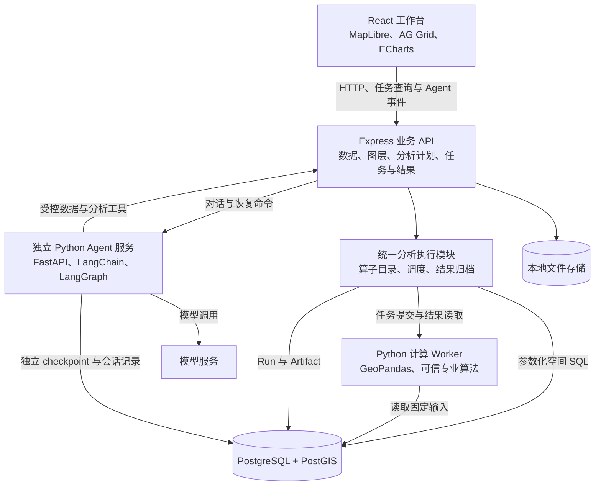

# GeoCSV 重构实施与 Agent 学习计划

编制日期为 2026-11-15。代码基线为 `agent-refactor` 分支的 `a08cf2f45ea75c232c0589d4765c038f059a3128`。

阶段 0 已于 2026-11-16 完成本轮约定的环境与核心功能基线，DeepSeek 官方模型调用已通过应用接口验收，详见 [环境与功能基线](environment-baseline.md)。阶段 1—7 待开始，文中的目标目录、接口和测试仍是拟议改动。既有能力以 [空间透视协议](spatial-pivot.md)、[自然语言实施记录](ai-refactor-progress.md) 和当前源码为依据；历史记录与本轮验证分开记录。

## 目标与投入

建设一个能够理解 GIS 需求、调用经过验证的算子、持续记录任务状态，并把结果呈现在地图与表格中的 Agent 工作台。以两个真实案例贯穿重构与学习。

- 案例 A 为街道内分类设施统计，使用现有 PostGIS 空间透视。
- 案例 B 为空间自相关，先审计现有 Python 算法，再评估接入 libpysal/esda，输出全局统计与局部结果图层。统计定义发生变化时发布新算子版本。
- 两个案例都通过同一套计划、任务和结果协议执行，支持表单与自然语言入口。

暂按单人维护、每周约 10 小时安排，预计 12—16 周。投入是学习与开发的估算，按验收完成度推进。每阶段采用“小实验 → 产品接入 → 故障验证 → 复盘”的方式，学习记录包含自己的解释、运行结果和遇到的问题。

## 目标架构与职责

Express 中对话代理路由与分析执行路由分别处理请求，Agent 工具只访问后者。模型和 Python GIS 依赖放在两个独立 Python 环境中。Agent 通过受控接口取得数据与运行结果，其数据库访问只用于会话和 checkpoint。

| 对象 | 维护方 | 需要表达的事实 |
| --- | --- | --- |
| Dataset | 业务 API | 文件身份、图层、字段、几何、CRS、内容版本 |
| Operator | 分析模块 | ID、版本、输入输出约束、执行器、能力边界 |
| AnalysisPlan | 分析模块 | 选定算子、参数、输入版本、计划版本及确认状态 |
| Run | 分析模块 | 一次被接受的计算及其状态、输入和结果引用 |
| Artifact | 分析模块 | 已提交结果的表格、几何、统计摘要及来源 |
| Conversation / Checkpoint | Agent 服务 | 消息、当前计划引用、澄清与确认进度、runId |
| ViewSpec | 前端与业务 API 的展示协议 | 图表类型、字段和样式选项 |

首次以本地单用户模式实施，内部接口使用服务凭据，服务端提供访问上下文。多人部署前增加用户身份、资源所有权和越权测试。模型参数中的用户 ID 不作为授权依据。

## 阶段总览

| 阶段 | 建议周次 | 工作量估算 | 产品交付 | 学习主题 |
| --- | --- | --- | --- | --- |
| 0 | 第 1 周 | 8—12 小时 | 可复现环境与回归基线 | 一次请求的完整数据流 |
| 1 | 第 2—3 周 | 16—20 小时 | 统一协议、幂等提交和迁移机制 | Tool Schema 与业务校验 |
| 2 | 第 4—5 周 | 20—24 小时 | PostGIS、Python 两种算子共用任务 | 工具执行、异步任务与故障边界 |
| 3 | 第 6—7 周 | 14—18 小时 | Python LangChain 规划服务 | Messages、结构化输出、Tool Calling |
| 4 | 第 8—10 周 | 24—30 小时 | LangGraph 澄清、确认、恢复闭环 | State、Node、Edge、Checkpoint、Interrupt |
| 5 | 第 11—12 周 | 16—20 小时 | 前端会话与结果统一，地图职责拆分 | Streaming、上下文与前端状态 |
| 6 | 第 13—14 周 | 12—16 小时 | 模型评估集与调用追踪 | Evals、Tracing、模型升级验证 |
| 7 | 第 15—16 周 | 10—16 小时 | 可部署版本与迁移收尾 | 服务生命周期与生产故障处理 |

阶段 1 → 2 → 3 → 4 按顺序推进。阶段 5 的基础模块拆分可在阶段 2 后进行，事件接入依赖阶段 4。部署与测试配置随各阶段维护，阶段 7 完成全链路验收。

## 阶段 0 · 环境与基线

进度：已完成两端安装、构建和 20 项单元/状态/流测试，真实 PostGIS 集成测试 1 项通过且 0 跳过；页面验证了边界计数、地图联动、CSV 和刷新恢复。Python 环境已锁定并进行读写驱动兼容性验证。DeepSeek 官方模型请求返回 ready/source: llm 并通过协议与数据校验；未将阶段 1 的架构改造提前纳入本轮。

### 模块改动

- 核对 `client/package.json`、`server/package.json` 与锁文件，记录经过验证的 Node 版本和安装方式。
- 为 `python_engine` 增加 `pyproject.toml`、依赖锁与环境变量模板，根据实际 import 确认 GIS 依赖和 Python 版本。
- 补齐应用、Python、测试 PostGIS 的启动说明与环境模板。用现有 `seed-spatial-demo.cjs` 建立小型已知答案样例。
- 检查 `AI_MIGRATION_RULES.md` 和 `.agents/rules/re-ai.md`，按当前架构更新动态执行、CRS、聚合规则和多 Agent 的描述，关联真实测试与协议。
- 更新 `docs/refactor-progress.md` 记录本轮结果，标明现有失败和未验证能力。

### 验收

1. 从干净环境按文档安装和启动前端、Node、Python、PostGIS。
2. 运行现有前后端构建与相关测试。PostGIS 集成测试必须实际执行，缺少 `TEST_DATABASE_URL` 导致的 skip 要标为未验收。
3. 表单统计得到排除边界的 2、1、0，纳入边界得到 3、2、0，地图、CSV 和历史结果可以读取。
4. 记录在线模型请求是否成功及失败类型。规则路径和表单链路作为独立验收项。

### 学习任务

自己画出“选图层 → 校验计划 → 创建 Run → 执行 → Artifact”的顺序图，说明参数、状态和计算结果分别在哪里产生。提交物是一页学习记录与真实运行证据。

## 阶段 1 · 分析协议与可靠提交

### 模块改动

- 从 `server/src/modules/spatialPivot/service.ts` 提取通用任务、结果逻辑到拟新增的 `server/src/modules/analysis/`。
- 在 `modules/operators/` 建立小型算子注册表，先注册现有 `spatial_pivot@1`，记录输入几何、参数、输出类型及执行入口。
- `spatialPivot/plan.ts` 保留算子专用校验和 SQL。`spatialPivot/router.ts` 适配通用服务，现有 URL 和成功响应保持兼容。
- 给创建任务接口增加请求幂等键，按访问主体和操作范围建立数据库唯一约束。同键同内容返回原 Run，同键不同内容返回冲突。主动重新计算使用新键。
- 引入持久化计划记录，关联计划版本、参数摘要和输入指纹。原表单提交继续可用，后续 Agent 确认接口引用这份计划。
- 将 `spatialPivot/schema.ts` 的表结构接入版本化迁移。现有库先核对实际结构再建立迁移基线，新库按迁移顺序创建。
- 发布 JSON Schema 或 OpenAPI 中的计划、任务、结果协议，并使用同一组契约样例验证 TypeScript 与后续 Python 解析。

### 验收

1. 旧 `SpatialPivotSpec`、已有 Run 和 Artifact 可继续解析、查看、导出。
2. 两个并发的同键提交只产生一个 Run。模拟提交成功但 HTTP 响应丢失，重试返回原 runId。
3. 相同参数配新键可主动创建新 Run。同键不同参数返回明确冲突。
4. 计划确认前输入变更时要求重新校验。排队期间输入变更仍按既有指纹策略拒绝执行。
5. 新库、现有库副本均能迁移，重复启动不重复应用迁移。

### 学习任务

把“街道内分类设施统计”写成工具输入 Schema，分别说明字段类型校验、图层存在性校验和计算语义校验的作用。测试未知字段、错误几何与不支持算子，记录三者在哪里被拒绝。

### 迁移策略

新增记录与字段采用兼容性迁移。先让原路由委托新服务，完成同输入结果对照后再迁移其他调用者。回退代码时先验证旧版本可以读取新数据，已创建结果由兼容读取器处理。

## 阶段 2 · Python 算子接入统一任务

### 模块改动

- 从 `analysisController.ts` 抽出空间自相关的参数转换与调用逻辑，增加 Python 执行器适配。
- 拆分 `python_engine/main.py` 中的 FastAPI 路由、请求模型、数据读取和空间自相关算法，拟放入 `api/`、`schemas/`、`operators/`、`data/`。
- 注册版本化空间自相关算子。输入显式记录字段、权重构建方法、CRS、置换次数和随机种子，核对现有算法定义后再确定最终参数协议。
- 建立通用结果类型，覆盖计数结果、浮点统计、局部分类与几何。读取器依据 Artifact 版本处理旧整数计数格式。
- Python 任务使用稳定执行 ID。Node 的提交、查询和取消由适配器完成，CPU 计算放入受监管子进程或 Worker。
- Python 执行前固定输入。首版可采用任务专属不可变输入快照，记录内容摘要并设置保留策略，避免计算过程中多次读取变化中的源表。
- Node 管理 Run 和最终 Artifact，Python 返回带执行 ID、输入摘要和算法版本的计算结果。重试、迟到返回和重复回调都需校验当前执行身份。
- 把调度初始化移到服务启动生命周期，增加退出时停止领取任务的行为。

### 验收

1. 两类算子使用同一任务接口、历史列表和结果读取协议。
2. 计数案例继续得到已知答案。空间自相关使用固定小样例和固定随机种子，先写清权重矩阵与统计定义，再以独立计算或已核对配置的参考实现验证数值及容差。
3. 空数据、常量字段、孤立要素、缺失 CRS 和不合法数值有明确行为。
4. Python 长任务执行时健康检查仍可响应。超时、进程退出和取消进入明确终态，迟到结果不能覆盖取消状态。
5. Node 在 Python 完成后、结果入库前退出，恢复后可按执行 ID取得结果并归档一次。
6. 数据更新不改变已完成结果。输入快照支持保留期内重放，快照过期时明确告知。

### 学习任务

手写一个 Python 客户端，依次提交任务、查询状态、取得结果。模拟一次超时，解释“HTTP 请求失败”和“计算失败”的区别，以及为什么重复消息需要幂等处理。

### 迁移策略

先迁移空间自相关，原专业模型接口通过适配器复用新逻辑。其他模型逐个迁移并单独验收。Python 跨进程计算采用执行 ID、状态核对与幂等归档，完成消息和数据库事务分别处理。

### 算法审计前置补充

2026-11-16 根据用户提供的学习对话补充。以下工作在阶段 0 建立清单、阶段 1 完善契约、阶段 2 完成空间自相关验证。空间自相关对照预计追加 8—16 小时，其余模型先明确适用范围和待验证项，实施时间依据盘点再估算。

现有计划覆盖了接口和执行可靠性，这次增加专业算法正确性与来源的明确验收。

| 工作 | 现有代码依据 | 实施与验收 |
| --- | --- | --- |
| 模型盘点 | `python_engine/main.py`、`analysisController.ts`、`llmService.ts` | 列出算子名称、业务用途、自编/第三方实现、公式来源、依赖、输入单位、CRS、输出及测试状态；复用同一算法的入口关联到同一项 |
| Moran/LISA 对照 | `_build_polygon_neighbors`、`_compute_spatial_autocorrelation` | 将 libpysal/esda 作为优先评估实现，固定要素顺序、权重、孤岛、局部统计归一化、置换机制、检验尾部和随机种子。分别解释统计量与 p 值的差异；相同 seed 在不同算法中不保证相同随机样本 |
| GeoDetector 分层 | `_calc_geodetector_q` 按因子原值分组 | 增加唯一值数、层数、单例层及每层样本量检查。现有逻辑在每个样本单独成层且因变量方差非零时会得到 q=1，应作为退化案例验收。连续因子需要显式分层方案并保存分层边界，离散化方法变化会改变模型定义 |
| 公园可达性语义 | `_normalize_distance_to_accessibility` 及其路由 | 核对距离字段来自直线距离、路网距离或出行时间，保存单位与来源。现有算子说明为距离字段评分与街道汇总。路网可达性另立算子，具备路网、出行方式与通行成本需求后再评估 OSMnx/pgRouting |
| 评价与分类方法 | 因子数值化、q 权重、`_classify_score_levels` | 核对类别编码是否具有可解释顺序、q 权重用于综合评分的依据。记录实际分类算法；自然断点失败后切分位数必须有明确结果说明和可复现参数 |

Operator 契约补充算法来源、实现标识、依赖锁摘要、参数单位、缺失值和孤岛策略、CRS 规则、适用条件与验证状态。Run/Artifact 保存实际实现版本和有效参数。地理统计显著性需区分检验定义，局部多重检验策略应显式说明。

执行器维度采用 `postgis` 或 `python`，PySAL、GeoPandas 等作为 Python 算子的实现依赖登记。同一 Worker 可执行多个可信库适配器，按资源与隔离需求再决定部署边界。

空间自相关先用小样本、已知权重矩阵和手工公式确认统计量，再对照选定稳定版本的 PySAL。随机检验使用可复现实验核对方法与分布，模型版本改变后旧 Artifact 保持其来源记录。参考 API 的开发版与稳定版可能有差异，实施时以锁定版本为准。[Moran 参数说明](https://pysal.org/esda/dev/generated/esda.Moran.html) · [Moran_Local 2.9 参数说明](https://pysal.org/esda/v2.9.0/source/generated/esda.Moran_Local.html)

学习侧可在阶段 0 基线通过后提前做只读 Tool Calling 小实验，使用图层元数据和算子能力两个现有接口。正式提交工具在阶段 1 幂等与阶段 4 确认机制完成后进入产品流程。等待任务完成由程序调度，模型按需要读取状态与结果摘要；结果行采用分页及数量上限。

附件中的工具名用于教学，实际实现沿用项目约定并记录对应接口。确认绑定服务端计划版本与交互记录，状态中的单个 `approved` 布尔值不足以表示完整确认信息。合法零计数保留为结果，数据有效性另行依据几何、范围、字段和空间关系检查。

## 阶段 3 · LangChain 与独立规划服务

### 模块改动

- 新增 `agent_service/`，包含 `pyproject.toml`、锁文件、FastAPI 入口、设置、模型适配和测试。
- 模型配置从环境读取，验证选定提供商的工具调用与结构化输出能力，记录实际依赖和模型版本。
- 封装 `get_datasets`、`get_operator`、`validate_analysis_plan`、`get_run`、`get_artifact` 工具，通过 HTTP 调用 Express。
- 在 `server/src/integrations/agent/` 增加服务客户端，对话代理端点单独组织。工具访问的数据/任务端点有显式服务认证与访问范围校验。
- 将 `analysisPlanner/provider.ts` 的模型草案职责迁到 Python。现有规则规划可继续作为确定性入口，规则未命中时调用新规划服务。
- 前端与业务执行使用原计划协议，模型返回值仍经过业务侧校验。

### 学习顺序

1. 直接调用模型并观察 Messages、模型响应和 usage。
2. 使用结构化输出和 Pydantic 描述计划，检查缺字段、额外字段和未知算子。
3. 用 `bind_tools` 手写一次模型请求工具、程序执行、ToolMessage 回传的循环。
4. 用 LangChain `create_agent` 完成同一任务，对照它封装的循环行为。
5. 将小实验的模型适配与工具函数接入产品，学习示例保留在 `agent_service/examples/`。

### 验收

1. 中文需求能映射到两个算子之一，输出引用真实数据集和字段。
2. 两个候选字段无法确定时提出可回答的问题，无法表达的需求返回 unsupported。
3. 模型返回 Python、SQL、未知图层、非法参数时，业务服务拒绝接受。
4. provider 超时、限流、无效 JSON 均有明确错误与调用上限。
5. 至少各完成一次真实模型规划，随后经表单确认执行，记录模型、计划与 Run 的对应关系。

网络受限时先完成固定模型响应的契约测试和工具集成，真实模型成功响应作为独立待验收项记录。

## 阶段 4 · LangGraph 编排与持久化恢复

### 模块改动

- 新增 `agent_service/graphs/analysis.py`、状态定义及独立 checkpoint 存储配置。
- 会话状态保存需求、选定数据 ID、计划 ID/版本、待答问题、runId、artifactId、错误与调用预算。大表和完整几何通过引用读取。
- 图节点按业务动作组织为读取上下文、规划、校验、澄清、确认、提交、读取任务、解释结果。规则规划和 LangChain 工具复用已有实现。
- 明确分支 `ready`、`clarification`、`unsupported`、`view_only`，为条件循环设置次数和时间上限。
- 使用 `interrupt()` 等待用户补充或确认，使用稳定 thread ID 和持久化 checkpointer 恢复。
- Express 增加会话消息、交互恢复、会话状态和取消接口。每条交互有 requestId，确认引用 planId、planVersion 及参数摘要。
- 提交节点使用阶段 1 的幂等键，并在提交前重新校验访问范围、计划版本和数据版本。
- 会话命令按会话串行处理，使用持久化版本检查避免多个浏览器页签同时覆盖状态。Agent 图运行与空间 Run 通过 ID 关联。

### 验收

1. 用户说“按类型统计”，系统询问图层，补充后形成完整计划并确认执行。
2. 等待确认时重启 Agent，恢复到同一计划。重复点击确认只创建一个 Run，旧版本确认返回冲突。
3. 在任务提交成功、checkpoint 尚未写入时注入中断，恢复后返回同一 Run。
4. 计算期间关闭浏览器，计算继续，重开后根据服务端状态恢复界面。Agent 重启后能重新关联已提交 Run。
5. “换成饼图”引用已有 Artifact，运行记录数量保持一致。修改计算参数则生成新计划。
6. 拒绝、取消、过期确认、重复恢复和并发对话各有独立用例。会话 A 的输入不能修改会话 B。
7. 持久化记录包含 graph/schema 版本。至少验证一个旧会话版本的兼容恢复，无法恢复的版本返回可操作提示。

### 学习任务

先用假工具构造三节点图并观察 State 更新，再加入条件边和 interrupt。分别在节点执行前、业务提交后、checkpoint 写入后模拟进程退出，用执行记录解释恢复行为。LangGraph 的持久化与中断机制参考官方文档。[图 API](https://docs.langchain.com/oss/python/langgraph/graph-api) · [持久化](https://docs.langchain.com/oss/python/langgraph/persistence) · [中断](https://docs.langchain.com/oss/python/langgraph/interrupts)

### 迁移策略

新建会话进入新编排，既有成功 Run 通过 contextRunId 引用。新功能通过配置逐步启用，回退时已有新会话和运行记录继续可查询，暂停接收其新执行请求并提示处理方式。

## 阶段 5 · 前端会话、地图与结果统一

2026-11-16 提前完成底图子任务：独立底图控制器、Protomaps 五主题目录、天地图矢量/影像后端代理、切换失败回退与业务图层保留。Protomaps 已在线验证，天地图受本机网络连接重置阻塞；详见 [地图接入记录](map-services.md)。这不代表阶段 5 整体完成，deck.gl、大数据性能及统一会话状态仍按本阶段推进。

### 模块改动

- `UnifiedAnalysisAssistant.tsx` 负责会话消息、澄清、计划卡片和恢复操作，业务请求移入 `client/src/services/agentService.ts`。
- `useAnalysisRun.ts`、`useRunHistoryStore.ts`、`AnalysisRunView.tsx` 扩展为通用 Run/Artifact 消费者，适配计数与空间自相关结果。
- 从 `GeoAIAgent.tsx` 逐项迁出流解析、消息状态和结果转换，历史实验 UI 通过明确适配入口维护。
- 从 `MapView.tsx` 拆出图层管理、数据源加载、样式和选择动作。新增 `focus_layer`、`highlight_features`、`set_chart` 等受约束前端动作，工具返回的动作先做运行时校验。
- `App.tsx`、`DataPivot.tsx`、地图和助手使用稳定图层 ID、结果 ID 共享选中与展示状态。
- Agent 状态事件增加 eventId、顺序号、conversationId、runId 和版本。前端合并重复事件，断线后重取权威快照，再补齐可恢复事件。
- 明确终态的优先级，迟到的 progress 不能把 succeeded/failed/cancelled 覆盖为 running。

### 验收

1. 同一结果从表单历史和助手打开时，表格、地图、图表与 CSV 数据一致。
2. 中文流分片、乱序、重复事件、断线重连和刷新后恢复均有测试。
3. 未识别事件不会修改图层或创建任务，跨会话事件被正确路由。
4. 调整图表、地图样式和选中要素时，Run 数量保持一致。
5. 属性表、文件上传、原地图图层和已迁移专业模型各完成一次浏览器回归。

### 学习任务

解释模型 token 流、工作流状态和计算进度这三种事件的区别。沿一条 trace 找到发起消息、工具调用、Run、Artifact 和最终地图动作。

### deck.gl 与大数据可视化专项

2026-11-16 补充。安排在阶段 5，阶段 1—2 明确结果协议后可提前做验证原型。专项预计增加 8—16 小时，完成范围根据实测决定。

MapLibre 管理底图、相机与常规矢量图层，deck.gl 承担需要 GPU 聚合、轨迹或三维表达的专题图层。两者共用稳定的数据集、图层和要素身份。引入 deck.gl 后，要同时关注数据传输、解码、内存、GPU 缓冲与拾取开销。

| 模块 | 计划改动 |
| --- | --- |
| `client/package.json` | 按试点选择 deck.gl 核心、MapLibre 集成与所需图层包，锁定兼容版本并按需加载 |
| `client/src/features/map/` | 增加独立的 deck.gl 适配器，管理 overlay 创建、图层更新和销毁，处理底图切换、选中和拾取 |
| `MapView.tsx` | 将专题图层交给适配器，通过统一图层描述选择渲染器，避免同一数据重复绘制 |
| `SpatialPivotResult.tsx` | 复用地图适配层，根据结果描述使用 GeoJSON 或版本化 MVT |
| `server/src/modules/spatialPivot/router.ts` 及后续通用结果模块 | 增加 Artifact MVT 读取，基于已归档结果几何生成瓦片，延续结果访问范围 |
| `Feature.ts`、两个现有瓦片入口 | 统一 source-layer、稳定 feature ID、字段与缓存版本，核对索引及查询计划 |
| Agent 展示协议 | 允许有限图层类型和参数，校验图层、字段、范围与数据完整性后渲染 |

实施顺序如下。

1. 以稳定小数据验证 MapLibre 与 deck.gl 相机同步、图层顺序和点击联动。按当时锁定版本确认集成 API，当前官方文档为 MapLibre 5 推荐 `@deck.gl/maplibre` 的 `MapLibreOverlay`。
2. 以已归档分析结果实现 MVT 数据源，突破当前结果 GeoJSON 接口的 5,000 目标预览限制。MVTLayer 只加载可见瓦片，历史结果瓦片取自 Artifact。
3. 试点设施密度视图，先选一个聚合图层，例如 HexagonLayer，再根据需求增加 HeatmapLayer。提供完整输入范围或明确的采样/视口范围说明。
4. 将“正式分析生成的聚合结果”和“浏览器探索性聚合”记录为不同展示来源。可见瓦片中的点可能被裁剪、简化或跨瓦片重复，聚合前必须核对范围和身份。
5. 用相同数据比较 MapLibre 原生 MVT 和 deck.gl MVTLayer；根据地图交互需求与实测确定每类图层的默认渲染器。

验收包括以下项目。

- 在固定机器、浏览器、窗口大小和数据分布下，比较 1 万、10 万、100 万点，以及指定顶点数量的复杂面。分别记录全库数量和视口实际加载数量。
- 记录冷/热缓存下首次可交互时间、请求体积、解码开销、内存、拖动缩放帧时间及拾取延迟；每种条件运行三次，报告中位数和较差样本。
- 数据引用稳定，切换面板或图表不会重新上传完整 GPU 数据。连续增删图层与切换底图后没有累积 overlay、监听器和持续内存增长。
- 大结果按可见瓦片加载；缩放后同一要素 ID 保持一致，点击可定位属性表和结果行，旧历史结果仍可显示。
- 浏览器聚合明确显示完整、采样或视口范围。正式统计及导出仍使用对应的后端 Artifact，并核对 GPU 聚合的浮点精度差异。
- WebGL2 或所需 GPU 功能不可用时，给出明确提示，并提供已验证的普通图层或服务端聚合展示路径。

试点阶段依据测试设备建立性能目标，再把目标写入验收记录。“百万级流畅”需要注明几何复杂度、属性负载、实际可见数量和硬件条件。[MapLibre 集成](https://deck.gl/docs/developer-guide/base-maps/using-with-maplibre) · [性能指南](https://deck.gl/docs/developer-guide/performance) · [MVTLayer](https://deck.gl/docs/api-reference/geo-layers/mvt-layer) · [聚合图层](https://deck.gl/docs/api-reference/aggregation-layers/overview)

## 阶段 6 · 评估与可观测性

### 模块改动

- 建立 `agent_service/evals/` 和固定数据集，初始建议 30—50 条人工核对样例，分为开发集和独立验收集。
- 样例覆盖明确统计、歧义、边界、视图追问、空间自相关、超范围请求、恶意字段内容和模型故障。
- 给 HTTP、模型、工具与计算日志传递 traceId，关联 conversationId、planId、runId、artifactId。
- 记录模型/提示词/算子版本、耗时、调用次数、usage 和失败类别，日志过滤密钥与不必要的业务内容。
- 在 `.github/workflows/` 接入已有 JS 测试、Python 测试和真实 PostGIS 集成测试。模型在线评估使用独立凭据与手动触发，费用上限可配置。

### 验收

1. 确定性计算、协议、幂等与隔离用例全部通过。
2. 记录首次真实模型基线。建议明确支持场景的计划正确率目标为至少 90%，报告分母、样例类别和失败原因。
3. 危险工具参数拒绝、同意前不提交、同键不重复、视图追问不重算这四类系统约束要求测试全部通过。
4. 在线模型重复运行三轮，报告波动和调用成本。失败样例能够通过 trace 定位到模型、校验、执行或展示环节。
5. 模型或提示词升级在同一验收集上比较，关键约束通过且规划质量达到既定基线后启用。

### 学习任务

比较两个模型或两份提示词，写出正确率、延迟与成本差异。理解评估样例与参考答案的作用，避免只挑成功截图。工具和结构化输出的接口使用官方文档核对。[模型](https://docs.langchain.com/oss/python/langchain/models) · [工具](https://docs.langchain.com/oss/python/langchain/tools)

## 阶段 7 · 部署与迁移收尾

### 模块改动

- 整理 Dockerfile、Compose、环境模板、健康检查和部署步骤，覆盖 Node API、Agent、Python 计算服务与 PostGIS。
- 在稳定数据目录中保存上传文件和输入快照，记录备份、保留期与恢复流程。
- 根据测量决定是否增加 Celery/Redis。若引入队列，明确消息重投、worker lease、取消和重复产物处理，复用现有 Run 身份。
- 按调用者清单迁移专业模型、公式、属性透视和旧 AI 入口。每迁移一项就记录功能等价、例外和可回退入口。
- 旧动态 Python 执行需要独立、无业务密钥的隔离环境和资源限制后，才进入面向其他用户的功能范围。
- 若部署给多人，补齐认证、数据集与结果所有权、服务间身份和越权测试。维护本地单用户配置与多人配置的显式差异。
- 根据实际 SQL 查询计划和前端耗时优化 MVT、分页和数据读取，建立相同数据与机器条件下的性能对照。

### 验收

1. 在新的环境中依照说明完成部署，执行两个端到端案例。
2. 服务退出、Agent 重启、数据库短时不可用、Python 超时和浏览器断线后，任务最终状态明确，无孤立的无限 running。
3. 从备份恢复数据库与必要文件，可读取旧结果并恢复符合版本条件的会话。
4. 用阶段 0 建立的功能清单完成回归，删除任何旧入口前确认已迁移的调用者与历史数据读取器。
5. 发布记录列出通过项、性能测量、已知限制和回退操作。

## 首个实施批次

第一次实施覆盖阶段 0，以及阶段 1 的幂等提交小范围改动。完成后用户即可看到有用的系统行为变化。

1. 复现现有空间透视，确认前后端构建及真实 PostGIS 测试结果。
2. 补齐当前 Python 环境描述，更新与源码矛盾的旧开发规则。
3. 为创建 Run 接口增加请求键和数据库唯一约束。
4. 增加“并发提交”和“响应丢失后重试”两类针对性测试。
5. 前端提交阶段保存并复用请求键，重试返回原任务，主动重算使用新键。
6. 验收演示中连续提交、断线重试均只新增一条记录，结果为 2、1、0，随后主动重算可新增第二条。

## 验证命令与证据

当前已经存在的命令如下，在相应目录执行。

| 目录 | 命令 | 验证内容 |
| --- | --- | --- |
| `server` | `npm run build` | TypeScript 构建 |
| `server` | `npm test` | 现有规划与空间协议测试 |
| `server` | `npm run test:integration` | 使用 TEST_DATABASE_URL 的真实 PostGIS 链路 |
| `client` | `npm run build` | 前端类型与生产构建 |
| `client` | `npm run test:analysis` | 任务历史状态合并 |
| `client` | `npm run test:pipeline` | 流协议解析 |
| 仓库根目录 | `git diff --check` | 差异空白检查 |

Python `uv run pytest`、Agent 在线评估和新 E2E 命令在对应阶段落地并写入包配置后使用。失败、跳过和未执行分别记录。旧项目存在的 lint 或构建问题先建立基线，本次触及模块的新增问题需要修复。

每阶段更新现有实施记录，包含提交版本、改动模块、通过/失败/跳过、样例结果与 runId、可复现命令和下一步。验收依赖真实行为，截图作为辅助。

## 后续学习扩展

基础八阶段完成后，再按真实功能需求继续扩展。

| 学习主题 | GeoCSV 场景 | 验收方式 |
| --- | --- | --- |
| RAG | 检索算子说明、参数含义和适用条件 | 引用可追溯，文档更新可检索，计算工具另行校验 |
| MCP | 向其他 Agent 客户端提供现有数据查询与分析能力 | 同一算子协议、身份和结果语义通过契约测试 |
| 多 Agent | 数据检查、分析与结果解释需要独立职责时开展试验 | 与单 Agent 基线比较正确率、延迟、成本与故障率 |
| 受控代码生成 | 用户需要注册尚未具备的算法 | 隔离试运行、输入输出测试、版本注册、显式发布 |
| 对象存储与 GeoParquet | 多机文件共享或大表扫描 | 用实测数据比较查询成本与一致性 |

这些主题作为后续学习分支，具体排期依据产品场景和前面阶段的评估结果确定。

## 参考依据

NeoGIS 后端参考提交为 `4635f5182d7c254b3b3283e7d789de1e44c7493e`，前端参考提交为 `1920529834d1afe153467c1df7ce410c9f7a5825`。本计划吸收独立 Agent、工具目录、任务执行、前端分层和自动验证的设计，部署规模按 GeoCSV 的实际维护能力安排。[NeoGIS 后端](https://github.com/GeoScenarioScripter/neogis-server-micro-service/tree/4635f5182d7c254b3b3283e7d789de1e44c7493e) · [NeoGIS 前端](https://github.com/GeoScenarioScripter/NeoGIS-Frontend/tree/1920529834d1afe153467c1df7ce410c9f7a5825)

阶段 3 实施时选择经过验证的 LangChain、LangGraph、模型适配器及 checkpointer 兼容版本，固定依赖锁，并用结构化输出、工具调用和暂停恢复测试确认实际行为。
