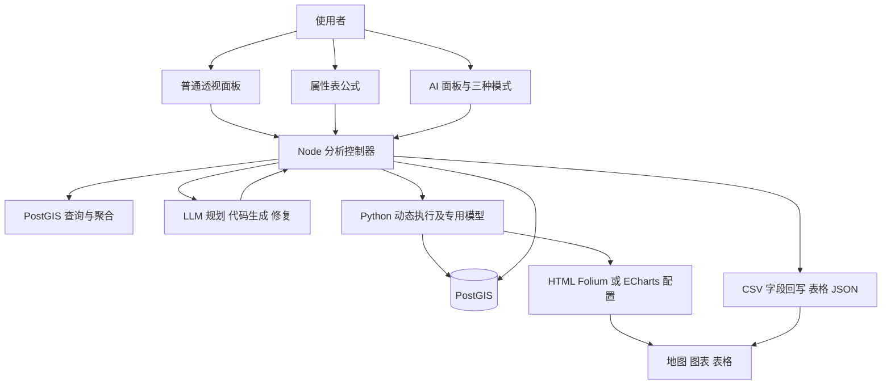
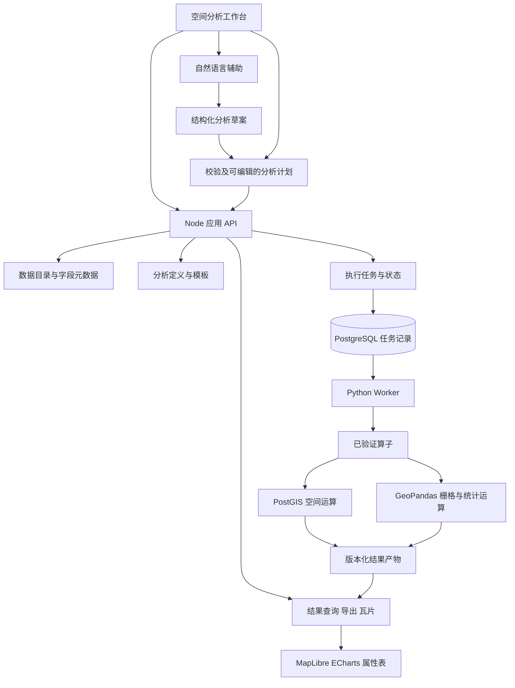

# GeoCSV 代码诊断与架构重设计

本文面向项目维护者，结合现有代码、README 和 `.agents/workflows` 中的项目背景，梳理软件定位、架构问题、目标设计与迁移顺序。核心结论：保留现有 WebGIS 和空间计算技术基础，把分散的功能入口收敛为可配置、可解释、可复现的空间分析流程。

分析日期：2026 年 10 月 26 日。下文的目标目录、协议、实体和接口是设计方案，尚未实现；“代码证据”描述的是当前工作区，包含原有未提交改动。

后续实施状态：首轮基础修复与行政区内分类 POI 统计已落地，详见 [实施记录](refactor-progress.md) 和 [空间透视协议](spatial-pivot.md)。下文的问题表保留初次诊断依据，已修项目以实施记录为准；完整目标架构仍按阶段迁移。

## 1 软件究竟解决什么问题

从项目原有“融合地理模型服务的在线数据透视分析平台”定位看，软件的核心价值是：让具备基础地理知识、但不希望编写脚本的使用者，将多源地理数据转成空间关系约束下的统计结果，并在地图和表格中检查、解释和复用。

这次按本地单用户研究和日常分析工具设计；多人协作、公开服务、租户权限不是第一阶段前提。

典型问题是：

- 每个街道内有多少类公共设施，设施密度是否均衡？
- 每个居住区周边 500 米内有多少公园，改成 1,000 米后结果怎样变化？
- 在既有结果上换一个分组、指标或图表，能否清楚区分重新计算与重新展示？
- 一次分析能否保存为模板，换一批数据后复用，并说明使用了什么数据、方法和参数？

一次完整使用流程应该是：导入并检查数据 → 绑定目标与关联图层 → 指定空间关系、维度和指标 → 检查分析计划 → 执行 → 地图、统计表和图表联动 → 保存分析与导出结果。

“在线数据透视”的特色在于空间约束与属性聚合的结合；“模型服务”的价值在于算法经过验证后能够参数化复用。聊天、Python 编辑器和图表库都是支撑这些目的的工具。

### 当前为什么容易显得鸡肋

1. 入口按实现方式划分。使用者需要理解“透视”“特征计算”“专业模型”等内部分类，才能选择正确路径。
2. 普通透视、公式、AI 和案例分支没有统一的分析对象。相近需求在不同入口下，参数解释、结果格式和保存行为会变化。
3. 结果主要表现为临时表格、图表、字段回写或新 CSV，缺少统一的分析历史与数据来源说明。
4. AI 生成代码和错误修复承担了过多正常业务逻辑。需求没有变，生成结果仍可能变化；用户也难以判断是数据、参数、算法还是绘图出了问题。

## 2 现有架构与代码规模

当前主要源文件约 30 个、合计约 16,800 行；这里统计 `client/src`、`server/src` 和 `python_engine` 下的 TS、TSX、Python 文件，不含依赖和构建文件。

| 位置 | 约行数 | 当前混合承担的职责 |
| --- | ---: | --- |
| `server/src/controllers/analysisController.ts` | 4,355 | HTTP、意图识别、案例匹配、Python SDK 字符串、空间统计、执行重试、图表、写库与导出 |
| `client/src/features/map/components/MapView.tsx` | 2,100 | 地图生命周期、数据请求、瓦片、图层、样式、网格、筛选、联动、导出 UI |
| `server/src/controllers/fileController.ts` | 1,691 | 上传、编码识别、文件格式转换、属性编辑、导出和旧迁移代码 |
| `python_engine/main.py` | 1,264 | API 模型、数据装载、动态执行、模型发现、专用统计与序列化 |
| `client/src/features/agent/components/GeoAIAgent.tsx` | 1,145 | 聊天 UI、上下文、流协议、代码编辑、结果识别、全局状态同步和案例逻辑 |
| `server/src/utils/llmService.ts` | 1,031 | 提供商配置、长提示词、规划、代码生成、代码修复和绘图生成 |
| `client/src/features/table/components/DataPivot.tsx` | 1,023 | 属性表、多文件标签、编辑、字段操作、公式及联动 |

文件长只是表象。真正的维护成本来自：同一业务规则散落多处，同一个组件或控制器又跨越多个业务边界。

当前大致存在以下并行链路：



## 3 已核实的代码问题

以下行号可用于定位；后续重构会改变行号。性能风险需要真实数据测量，不能用文件长度或静态检查替代性能结论。

| 优先级 | 问题及代码证据 | 影响与处理方向 |
| --- | --- | --- |
| 高 | `App.tsx:49,238,248` 以文件名索引数据缓存 | 不同目录中的同名文件可能串数据。统一使用 `datasetId`，并用数据版本、分页、筛选组成查询键。 |
| 高 | `GeoAIAgent.tsx:402–406` 在空 `catch` 中吞掉错误事件和解析异常 | 服务端报错可能没有失败提示，流结束也没有最终结果校验。将流解析独立为服务，区分网络、协议、执行错误。 |
| 高 | `analysisController.ts:4284,4292,4308` 在绘图重试循环前构造 `finalChartCode`，修复后只修改 `chartCodeOrMetadata` | 修复后的代码没有进入下一次请求，重试仍执行旧版本。这是确定的逻辑缺陷。 |
| 高 | `analysisController.ts:4060–4099` 将空数组保存到 `aggregatedData` 后抛错，但最终只检查 `!aggregatedData` | 空数组为真，重试失败后可能继续按成功路径处理。应使用明确的成功状态，并允许协议表达合法空结果。 |
| 高 | `analysisController.ts:2481–2536` 将请求中的字段名直接插入 SQL 字符串 | 含单引号的字段会破坏查询，也存在 SQL 注入风险。JSONB 键使用参数绑定，并校验字段及聚合方法。 |
| 高 | `python_engine/main.py:284,452,1227` 使用进程内 `exec`，入口为 `async def` | 动态代码和同步 GIS 计算没有独立进程边界、执行时限和资源约束。异常或长任务会影响服务响应；不能据此称为隔离沙盒。 |
| 高 | `python_engine/main.py:242–245` 与 SDK 中 `ensure_metric_crs` 默认采用 EPSG:3857 | 地图显示投影被当成通用分析投影。距离和面积计算应有独立 CRS 策略，并记录到执行记录。 |
| 中 | `analysisController.ts:1558–2390` 在 TS 字符串中维护多组 Python SDK，重复定义 `ensure_metric_crs` | Python 代码难以独立检查、测试和复用；类似逻辑逐渐分叉。正式算法应回归 Python 模块。 |
| 中 | 同一分析控制器含公园可达性、滑坡敏感性、Moran/LISA 的关键词推断、代码生成、写库和制图 | 新增案例需要改核心流程，边界越来越不清楚。基础算子归算子模块，案例归模板及专用模型。 |
| 中 | `App.tsx:253` 每次渲染新建图层数组，`MapView.tsx:504–611` 以其引用为 effect 依赖 | 父组件重渲染会触发额外图层清除和重建。元数据初始为 0 时，还可能提前发起全量请求。 |
| 中 | `Feature.ts:285–320` 的 schema 摘要只取一条记录 | 容易漏掉后续记录字段，不包含字段类型分布、空值比例、真实 CRS 和几何质量。 |
| 中 | `Feature.ts:355` 和 `tileController.ts:46` 在过滤条件中转换整列几何；建表只给原 `geom` 建 GiST 索引 | 现有原列索引与转换后的表达式不匹配，需要审查查询计划。优先将查询范围转换到原坐标系后预过滤，或使用经验证的表达式索引。 |
| 中 | `/api/tiles/...` 与 `/api/files/.../tiles/...` 两套瓦片链路，图层名分别为 `default_layer`、`features` | 客户端维护两套协议。统一接口、图层名、稳定 feature ID 和按数据版本失效的缓存。 |
| 中 | `python_engine/main.py:113–114` 已建立 `with ... as conn`，却再次调用 `engine.connect()` 读取 | 新连接没有被该上下文管理，可能占用连接池。复用已有连接，并测试异常释放。 |
| 中 | `main.py` 启动时加载模型，只在名称不存在时重扫；注册端可覆盖同名 `.py` | 同名模型更新后可能继续执行内存里的旧函数。需要算子版本和明确的加载/失效机制。 |
| 中 | 前端通过 `window.dispatchEvent` 刷新数据树与表格；上下文传回部分表格和代码 | 组件之间形成隐式依赖，部分结果不能当完整事实来源。用结果 ID、明确事件和统一查询失效替代。 |

补充说明：额外地图图层已经有 MVT，不能说“只有主图层使用瓦片”。当前主图层通常走 MVT，额外图层以 5,000 条为阈值选择 MVT 或全量 GeoJSON。需要解决的是两套瓦片协议、元数据尚未就绪时的请求、重复挂载，以及“加载全部”仍可一次请求百万行的问题。

## 4 目标架构

采用“模块化应用服务 + 独立 Python 计算 Worker + PostGIS”的结构。沿用 React、TypeScript、Express、FastAPI、MapLibre、ECharts 和 GeoPandas；先收敛业务边界，不同时换框架。



关键边界如下：

| 模块 | 负责 | 对外提供 |
| --- | --- | --- |
| 数据目录 | 上传、格式识别、数据 ID、版本、字段与几何质量 | Dataset 元数据、预览、字段 schema |
| 分析服务 | 分析定义、参数绑定、字段与单位校验 | 可执行的 AnalysisSpec |
| AI 辅助 | 将需求映射为草案、解释参数、提出候选模型 | 结构化草案或视图修改建议 |
| 任务服务与 Worker | 排队、认领、执行、取消、超时、错误与结果登记 | Run 状态及 Artifact 引用 |
| 算子库 | 明确输入输出的空间关系、聚合和专用算法 | 带版本的确定性计算能力 |
| 结果服务 | 结果预览、统计、分页、瓦片、导出 | 稳定的结果查询接口 |
| 展示层 | 视图配置、图层样式、图表和选中联动 | ViewSpec；不改变算法含义 |

Node 提供用户交互 API、规划与业务校验；Python 负责空间计算实现。PostGIS 仍可承担分析的实际空间查询，SQL 与 GeoPandas 是算子内部的执行策略。相同算法不能再由 Node/Turf 和 Python 各维护一份相互漂移的定义。

任务调度第一阶段使用现有 PostgreSQL 保存执行记录，配一个并发数为 1 的独立 Python Worker 进程。Worker 从现有 `python_engine` 演进，FastAPI 在迁移期只保留兼容入口，不在 API 进程中执行长计算。先实现创建、状态、超时、取消和重启后标记中断；自动重试先限于无副作用的阶段。多 Worker 的认领令牌、心跳与租约在确实需要并发扩展时补充，再评估额外队列设施。

## 5 统一计算协议与视图协议

### AnalysisSpec 表达要算什么

空间透视保留项目已有的六要素：目标对象、空间约束、行维度、列维度、聚合方法、统计字段。把它们变成经过运行时校验的协议，不能只藏在提示词里。缓冲、分区统计、Moran/LISA 等其他算子使用各自有类型的参数定义；不强行把每一种地理模型都塞进透视六要素。

例如“统计各街道内不同类型 POI 的数量”：

```json
{
  "schemaVersion": 1,
  "kind": "spatial_pivot",
  "operator": { "id": "spatial_pivot", "version": "1" },
  "inputs": {
    "target": { "datasetId": "streets", "version": "1" },
    "join": { "datasetId": "pois", "version": "1" }
  },
  "spatial": {
    "relation": "contains",
    "boundaryPolicy": "exclude",
    "matchPolicy": "all_matches"
  },
  "rows": [{ "source": "target", "field": "street_code" }],
  "columns": [{ "source": "join", "field": "category" }],
  "measures": [{ "method": "count", "source": "join", "distinctBy": "feature_id" }],
  "unmatchedTargets": "keep"
}
```

这个示例明确排除边界点、保留未匹配街道，并允许一个对象匹配多个目标；实际界面应解释这些规则。其他业务可以选择包括边界或单归属，但不能由实现细节悄悄决定。

需要强制明确的语义：

- 所有数据绑定使用 ID 和版本；显示名不能充当主键。
- 系统要素 ID 与用户表中的 `id` 字段分开。聚合结果保留目标要素映射，用于地图联动。
- count、sum、mean 的无匹配与缺失值行为分别定义；不能所有情况都填 0，也不能把合法的数值 0 一概当脏数据。
- 区分按每个目标要素汇总和按类别分组。原规则中“所有聚合必须 groupby(level=0)”只能适用于部分逐要素回写，不能作为所有透视分析的统一规则。
- 数据缺少 CRS 时要求确认来源；距离、面积记录单位和分析 CRS。3857 用于地图显示，并不自动满足精确测量要求。
- 空结果可以是合法结果，例如指定范围内没有设施；与执行失败使用不同状态表达。

### ViewSpec 表达怎么看

视图独立引用结果产物，例如：结果 ID、地图专题字段与分级、图表维度与指标、颜色、标签和图层可见性。图表配置不再反过来充当聚合指标的事实来源。

“换成柱状图”“颜色改为蓝色”只更新 ViewSpec。“缓冲区改成 1,000 米”“把均值改成总和”则生成新 AnalysisSpec 和新 Run。二者通过明确协议区分。

### AI 与表单共用同一计算入口

普通用户通过表单填写协议，AI 根据自然语言提出同样的协议。后端对两条路径执行同样的字段、数据类型、空间关系、单位和算子能力校验。AI 输出不直接执行，缺少关键参数时呈现待补充项。

已有内置算子可以完成的任务不需要生成 Python。暂不支持的需求进入“实验模型”流程：候选代码 → 独立受限环境试运行 → 样例与边界检查 → 用户审阅 → 注册固定版本。语法校验和正常子进程都不等同于不可信代码沙盒；启用不可信执行之前，需要落实低权限、文件与网络访问边界及资源限制。

## 6 五类核心业务对象

| 对象 | 表达的含义 | 必须保留的信息 |
| --- | --- | --- |
| Dataset | 可查询的数据集，不等同于磁盘文件 | 稳定 ID、数据版本、原始文件引用、字段 schema、CRS、要素数、几何类型与质量摘要 |
| AnalysisDefinition | 可复用的分析定义或模板，单次执行不覆盖它 | 定义版本、输入角色、参数约束和默认值、描述；执行时展开为绑定具体数据的 AnalysisSpec |
| Operator | 系统支持的一种算法能力 | 名称、固定版本、输入输出 schema、实现引用、依赖环境与验证状态 |
| Run | 对特定输入和参数的一次执行 | 分析协议快照、数据版本、算子版本、解析后的 CRS、软件环境、随机种子、状态、耗时及错误 |
| Artifact | 执行产生的结果产物 | 来源 Run、表格或图层数据引用、字段、统计摘要、导出引用 |

DatasetVersion 和 ViewSpec 是相关的版本与展示记录，不要求第一轮就拆成独立服务。

Workspace 是组织这些对象的工作区外壳。当前 `file_nodes` 适合保留为资源树和文件引用，逐步与可计算的 Dataset 区分；现有 `spatial_features` 可作为过渡数据存储，迁移时再补稳定标识和版本关联。

分析默认生成新结果，源数据保留。现有“算完立刻覆盖源图层字段”的功能迁为显式的“应用结果到数据集”，并生成新版本。否则用户无法知道第二次分析是否已经使用被第一次修改的数据。

## 7 执行与数据访问

建议接口以业务对象组织：

```text
POST /api/analysis-plans       自然语言或表单生成并校验分析计划
POST /api/runs                创建执行记录，快速返回 runId
GET  /api/runs/:id             查询状态和结果引用
GET  /api/runs/:id/events      订阅进度，重连后仍可查询实际状态
POST /api/runs/:id/cancel      请求取消
GET  /api/artifacts/:id/rows   分页读取统计结果
GET  /api/datasets/:id/tiles/{z}/{x}/{y} 统一地图瓦片协议
```

旧接口先保留为适配层，逐个委托新服务，避免一次替换全部前后端调用。

执行生命周期应包含 queued、running、succeeded、failed、cancelled；取消请求和超时单独记录。首期重启后明确标记未完成任务并支持手动重跑；后续扩展再增加心跳、租约及自动恢复。不能在只关闭浏览器连接时就声称计算已取消。子进程退出、数据库语句取消和结果提交需要协同处理。

Worker 只读取固定版本输入。结果先写入本次尝试的暂存区，校验完成后用短事务登记 Artifact、数据版本和成功状态；失败或重试不能暴露半成品。文件存储与数据库之间通过暂存、最终登记和孤儿清理保持一致，不假设跨存储存在一个大事务。

前端请求创建任务后不持有整条分钟级计算请求。进度通道是展示，Run 记录是执行事实。错误至少区分输入校验、数据质量、计算、超时和制图；制图失败仍应允许访问已经成功生成的计算结果。

数据访问原则：

- 地图使用统一 MVT 或受限的视口查询；属性表分页；图表查询聚合结果。
- 首次导入建立真实字段与几何质量摘要，不从第一页或第一条记录推断全部 schema。
- 不把全量表格当作聊天上下文发送；使用 Dataset、Run 和 Artifact 引用，必要时提供有边界的样本。
- 分组联动使用要素映射或服务端筛选表达式，避免传输巨大 ID 数组。
- 简单空间筛选与聚合优先利用 PostGIS，栅格和特定统计使用 Python；根据实测再调整执行策略。

## 8 代码应如何拆分与整理

下面是逐步迁移后的职责示例，不建议立即创建一堆空文件夹：

```text
client/src/
  app/                         工作台编排与布局
  features/datasets/           数据目录、上传、预览
  features/analysis/           分析计划、参数表单、模板
  features/runs/               执行进度与历史
  features/results/            结果表、地图与图表视图
  features/assistant/          AI 草案与解释
  services/                    API 与协议适配

server/src/
  modules/datasets/            controller service repository
  modules/analyses/            计划校验与定义
  modules/operators/           算子元数据与版本
  modules/runs/                任务创建、状态与取消
  modules/results/             结果读取、瓦片与导出
  integrations/llm/            提供商、结构化输出与提示词
  config/                     环境配置

python_engine/
  api/                         迁移期间的兼容 API
  worker/                      任务认领、执行、超时和结果登记
  core/                        数据装载、CRS、输出格式与错误
  operators/                   正式空间算子、统计与栅格模型
  experiments/                 尚未正式发布的候选模型

contracts/                     协议 schema 和版本规则
docs/                          架构、运行说明与迁移记录
```

前端继续使用 Zustand 管理 UI 与选择状态，但将 Dataset、Run、Artifact 的服务端数据与地图样式、面板开关分开。选中联动统一为 datasetId、datasetVersion、featureId 或结果分组筛选；不再回退到名称作为身份。

MapView 先拆数据源与图层生命周期、专题样式、选中联动三个边界。GeoAIAgent 先拆流协议、会话引用与结果动作。控制器只做请求解析和服务调用；先搬现有逻辑到明确模块，再通过可对照的测试改变行为。

### 冗余内容的不同处理方式

| 内容 | 处理方式 |
| --- | --- |
| 多份 Python SDK 字符串与重复 CRS 处理 | 抽回 Python 正式模块，统一导入及协议；迁移前保留旧入口适配 |
| 多套生成、修复、重跑和保存分支 | 共用执行管线，按算子和结果类型分派；保留必要算法差异 |
| 公园可达性、滑坡、地理探测器、Moran/LISA | 算法保留为专用算子，数据字段别名与制图布局整理为案例模板 |
| Folium、Plotly HTML 与原生地图图表双链路 | 主流程逐步收敛为结果数据和前端视图；旧 HTML 作为历史兼容，替代完成后移除 |
| MongoDB 迁移注释、注释掉的旧实现、补丁文本 | 确认没有活跃引用后清理；有价值的设计说明迁到文档 |
| 根目录 `tmp_chart_*`、请求样例、执行输出、论文材料 | 按调试样例、回归数据、论文素材归档；保留有意义样例并控制数据体积，不直接批量删除 |
| `.agents` 与 `AI_MIGRATION_RULES.md` | 用最终架构决策替代相互矛盾的旧规则；例如禁止所有 merge、所有 groupby 的规则应改成明确的身份与聚合语义约束 |

## 9 迁移顺序及验收

### 阶段一 建立可比较的基线

记录现有环境、数据结构和典型分析输入输出，补齐运行说明与依赖清单。修复确定性缺陷：同名缓存、流错误、无效重试、字段参数化、连接释放。保护当前工作区的未提交成果。

验收：同名文件不串数据；错误有明确终态；一条无 AI 的分析可重复执行并得到相同结果；合法空结果有正常表达。

### 阶段二 以一条空间透视链路建立新核心

先选“行政区内分类 POI 统计”，建立 AnalysisSpec、Operator、Run 与 Artifact。表单和 AI 草案共用它，保留旧路由适配。将涉及的 Python 逻辑从 TS 字符串搬回模块。

验收：两种入口产生等价协议；固定输入和版本时结果一致；源数据没有被分析隐式修改；每次执行能查到参数、结果和错误；边界点、重复 ID、无匹配、空值规则均有样例。

### 阶段三 统一结果展示并补充缓冲分析

让属性表、地图和图表都读取 Artifact，合并瓦片协议，稳定图层生命周期。增加距离参数、分析 CRS 与缓冲统计，独立保存 ViewSpec。

验收：改图表和颜色不触发计算；改缓冲距离创建新 Run；地图显示全部目标与统计对应；图层不会因无关 UI 更新反复下载；数据规模目标用明确样例与机器配置实测。

### 阶段四 迁移专业模型与实验算子

逐个将案例分支整理为正式算子和模板，完成后再收缩旧流程。实验代码保持单独生命周期，只有通过验证的版本才进入正式工具箱。

验收：同名算子更新能明确选择版本；历史结果可追溯；专用算法有小型已知答案样例；取消、超时和 Worker 异常不会把任务留在永久执行状态。

迁移期间每完成一条新链路，再删除对应的旧实现。不要先全量移动文件、改名和升级依赖，再同时排查行为差异。

## 10 本轮已落地的范围与验证

本轮主要完成诊断与设计，没有执行数据库迁移，也没有重写分析算法。

已做的小范围代码改进：新增统一 API 地址配置 `client/src/services/apiConfig.ts`，axios、文件树请求、AI 流请求和两套现有地图瓦片请求使用相同配置；Vite 开发环境将 `/api` 代理至本地 3000 端口。`client/.env.example` 给出配置方式，并在根忽略规则中允许保存这个示例。

默认使用同源 `/api`；生产部署需要同源反向代理，或在构建时设置 `VITE_API_BASE_URL` 为真实 API 地址。Vite 开发代理不等于生产代理。后端数据库地址、Python 引擎地址和 LLM 代理配置仍待整理。

验证结果：前端 `npm run build` 通过；后端当前代码 `tsc --noEmit` 基线通过；Python 入口通过 AST 语法检查；新增 API 配置与 Vite 配置的定向 ESLint 检查通过；本轮修改通过 `git diff --check`。前端构建仍提示单个 JS 包约 4.34 MB，后续需要按工作区、地图和分析功能实测加载成本并拆包。

当前 Windows 默认 Python 未安装 FastAPI、GeoPandas 等项目运行依赖，检查时未发现 3000、5173、5432、8000 端口正在监听；代码注释提到 WSL2 运行 Python，因此这不能证明原有 WSL 环境不可用。本轮未据此安装依赖、启动数据库或对业务数据做读写验证。上述构建和语法检查不等于空间算法正确性或端到端验收。

## 11 设计依据

- 项目定位与历史意图：`README.md`、`.agents/workflows/2-ai.md`、`AI_MIGRATION_RULES.md`；历史方案中已经实现的能力以实际代码为准。
- [FastAPI 的异步、并发与并行说明](https://fastapi.tiangolo.com/async/)：同步计算与异步 API 的执行边界需要明确，CPU 密集工作可通过独立进程处理。
- [PostGIS 距离计算](https://postgis.net/docs/ST_Distance.html)：geometry 与 geography 使用不同的距离语义；Web Mercator 测距受投影变形影响。
- [PostGIS 坐标转换与表达式索引](https://postgis.net/docs/ST_Transform.html)：转换几何与指定 SRID 是不同操作，常用转换表达式需要匹配索引策略。
- [PostGIS 空间查询与索引](https://postgis.net/docs/using_postgis_query.html)：空间查询性能依赖正确的谓词、索引和查询设计。
- [PostgreSQL SELECT 与 SKIP LOCKED](https://www.postgresql.org/docs/current/sql-select.html)：提供队列消费者可用的行锁机制；任务超时、租约、重试和恢复仍需应用实现。
