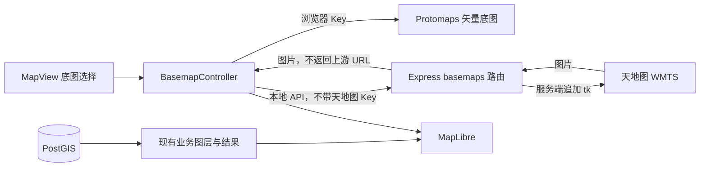

# GeoCSV 地图服务接入与学习记录

实施日期：2026-11-16。参考 NeoGIS 的 Protomaps 矢量底图和天地图服务端代理方案，保持 GeoCSV 现有 React/Vite、MapLibre 与 Express 架构。

## 配置两把 Key

前端 `client/.env.local`（本机已填写用户提供的 Key，保留其他配置）：

```dotenv
VITE_PROTOMAPS_API_KEY=你的ProtomapsKey
```

后端 `server/.env`（保留 DATABASE_URL、DeepSeek 等其他字段）：

```dotenv
TIANDITU_SERVER_KEY=你的天地图服务端Key
```

真实配置均被 Git 忽略。Protomaps Key 用于前端 Hosted API，构建后会出现在浏览器请求中，应在账户中限制允许来源。天地图必须使用“服务端”类型 Key，不能放入任何 `VITE_*` 变量。此前的 `VITE_TIANDITU_KEY` 浏览器直连方式已移除。

申请入口：

- [Protomaps 账户](https://protomaps.com/account)：注册/登录，创建 API Key，设置允许来源。本机使用 `http://127.0.0.1:5173` 和 `http://localhost:5173`，以后添加正式来源；[官方 Hosted API 文档](https://protomaps.com/api)。
- [天地图官网](https://www.tianditu.gov.cn/) → 开发资源 → [控制台](https://console.tianditu.gov.cn/api/key)：按提示认证，创建 GeoCSV 应用，选择“服务端”；按控制台要求配置实际服务出口 IP 等限制。

修改前端配置后重启 Vite，修改后端配置后重启 Node。生产构建的 `VITE_*` 在构建时写入，必须重新构建。

| 选项 | 配置条件 | 图层 |
| --- | --- | --- |
| Protomaps light/white/grayscale/dark/black | 前端 Protomaps Key | 矢量样式、瓦片、字体与图标 |
| 天地图矢量 | 后端服务端 Key | vec 底图 + cva 中文注记 |
| 天地图影像 | 后端服务端 Key | img 底图 + cia 中文注记 |

工作地图默认加载 Protomaps light。只配置天地图时可在菜单中选择天地图底图。未配置的选项禁用。配置状态接口只判断 Key 是否填写。后端不可达显示“服务不可用”。切换失败时会提示，并保留已加载的底图。

## 请求经过哪些模块



### 前端：切换底图与业务图层保留

`client/src/features/map/basemaps.ts` 包含目录、样式加载和控制器；`MapView.tsx` 负责用户选择、配置状态和错误提示。

控制器给底图图层和数据源加独立前缀，插入透明的 `geocsv-basemap-anchor` 下方，用户数据图层在上方。切换只删除底图自己拥有的资源，保持 GeoJSON/MVT 数据源、选中要素过滤条件和相机。没有调用整图 setStyle，也不重新加载用户数据。

Protomaps Style JSON 带有矢量源、绘制规则、字体和 sprite；控制器同步这些资源。当前业务图层使用 fill/line/circle，不依赖自己的全局字体和 sprite；未来加入业务符号体系时，需要扩展图标命名空间和字体资源约定。

切换顺序为：加载样式 → 暂存候选资源 → 等待当前视窗就绪 → 移除旧底图。样式无效、请求失败或超时会清理候选并恢复旧字体/图标。快速连续选择时取消旧请求，最后一次选择生效；卸载页面会终止等待。当前视窗成功不等于所有缩放层级都已验证，后续移动地图仍可能遇到上游瓦片故障。

### 后端：固定服务地址与凭据边界

`server/src/modules/basemaps/router.ts` 提供：

- `GET /api/basemaps`：只返回天地图 Key 是否存在。
- `GET /api/basemap-tiles/tianditu/:layer/:z/:x/:y`：只允许 vec/cva/img/cia，z 为 0–18，x/y 在相应矩阵范围内。

后端生成固定 HTTPS 天地图地址，拒绝查询参数、任意上游地址和重定向。浏览器不能指定其他代理目的地或覆盖 Key。代理限制并发、响应大小和等待时间，浏览器断开时取消上游请求。只返回符合 MIME 和文件签名的 PNG/JPEG/WebP；上游正文、带 Key 地址与异常对象不透传。默认不缓存第三方瓦片，后续需确认服务授权再决定缓存策略。

当前没有统一用户认证，这两个新接口仅接受直接连接来自本机的请求，不信任 X-Forwarded-For。Vite 本机代理可以使用。如果将 Vite、Nginx 等本机代理公开到公网，必须在入口加入身份验证与使用限额；本机 socket 限制不能识别反向代理背后的公网用户。其他业务路由不受此限制影响。

## 验证与学习

```powershell
# server
npm test
npm run build

# client
npm run test:basemaps
npm run test:analysis
npm run test:pipeline
npm run build
```

离线测试模拟上游，不消耗真实 Key 额度。覆盖图层组合、业务图层保留、切换竞态、失败回退、超时、非法代理输入、Key 不泄漏、图片限制、并发和断开清理。

完整在线验收清单：

1. 选择街道和设施样例，确认两个业务图层可见。
2. 切换 Protomaps 深浅主题、天地图矢量和影像；检查中文注记、平移与缩放。
3. 确认业务图层、选择状态和视角保持；天地图浏览器请求只能指向本地代理，不能出现 tk。
4. 使用无效 Key 检查提示与旧底图保留，再恢复有效配置并重启。

2026-11-16 实测：两把 Key 已写入被 Git 忽略的本地配置。Protomaps light 与 dark 在浏览器中成功加载，南京道路、水系和注记可见，街道面与四个设施点在切换后保留。切换天地图矢量时请求失败，页面恢复原 Protomaps 底图，业务图层仍保留。截图见 [Protomaps 与业务图层](screenshots/map-services-2026-11-16.png)。

天地图在线验收仍受网络阻塞：Node HTTPS 直连 t0/t1、系统代理请求，以及显式使用本机既有代理 127.0.0.1:7897 的请求均未取得 HTTP 响应；Node 返回 ECONNRESET。本机 t0 DNS 解析落到 198.18.0.73 的 fake-IP 网段，提示请求经过本机网络代理，但不足以断定具体故障原因。代理接口向前端返回脱敏 502。尚不能判断 Key 是否有效，也没有验收真实天地图影像与中文注记；未更改系统代理、DNS 或降低 HTTPS 校验。后续应检查现有代理中天地图域名的分流及可达性，再重复上述清单。

自动验证：服务端 20 项测试、前端底图 9 项、分析状态 3 项、流协议 6 项通过；前后端构建通过。前端既有大包体积警告仍在，本次没有引入新的地图依赖。

学习练习：沿 rasterStyle 看 vec/cva 如何组成一个选项；沿后端 URL 构造看 tk 在哪里加入；沿 switchTo 看样式下载成功与资源真正加载成功有什么区别。
